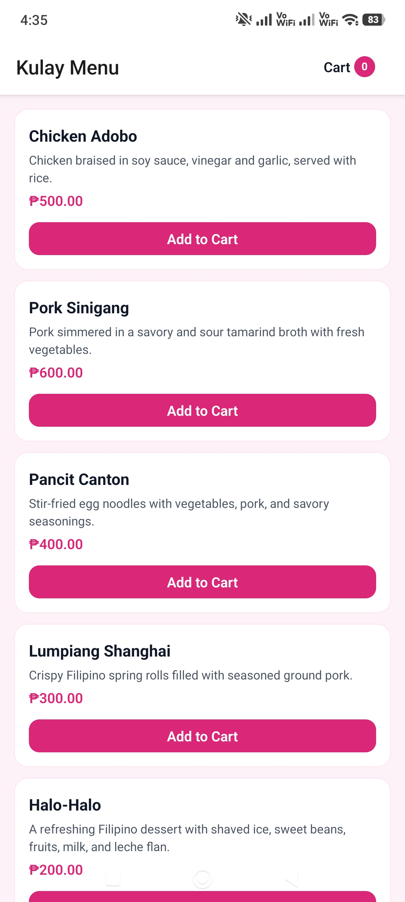
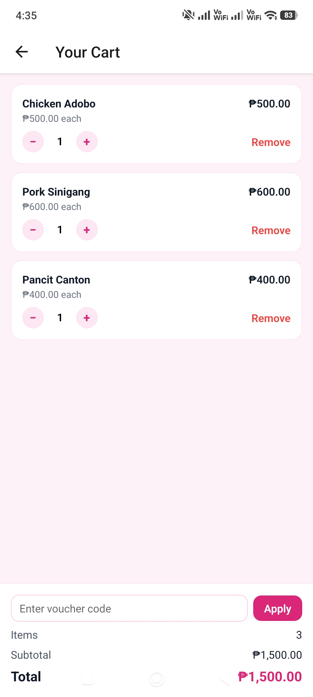
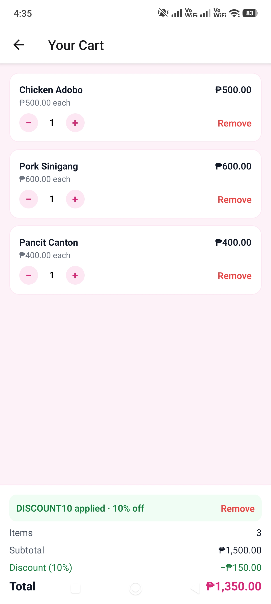

# Kulay Cart

A simple React Native "Add to Cart" app built for the Kulay mini task.

## Features
- Menu of 5 static products (name, description, price)
- Add to cart, change quantity, and remove items
- Real-time item count (header badge) and total
- Voucher: `discount10` gives 10% off (case-insensitive)
- Cart and voucher are saved on the device, so they survive an app restart

## Tech stack
- React Native + Expo (SDK 58), TypeScript
- Expo Router (Menu and Cart screens)
- NativeWind (Tailwind CSS for React Native)
- AsyncStorage (local persistence)

## How hooks are used
| Hook | Where | Why |
|---|---|---|
| `useReducer` | `context/cart-context.tsx` | All cart changes (add, increase, decrease, remove) go through one reducer |
| `useContext` | `hooks/use-cart.ts` | Shares the cart with every screen without passing props |
| Custom hook `useCart()` | `hooks/use-cart.ts` | One simple way for components to read and update the cart |
| `useMemo` | `context/cart-context.tsx` | Item count, subtotal and discount recalculate only when the cart or voucher changes |
| `useEffect` | `context/cart-context.tsx` | Loads the saved cart on start, and saves it whenever it changes |
| `useState` | `components/voucher-input.tsx`, `context/cart-context.tsx` | Voucher input text, error message, applied voucher |

## Project structure
```
src/
   app/          Screens (Expo Router): menu (index) and cart
   components/   ProductCard, CartItemRow, CartBadge, VoucherInput
   context/      Cart reducer and CartProvider
   hooks/        useCart custom hook
   data/         Static products
   types/        Product and CartItem types
   constants/    UI strings
   utils/        Price formatting and voucher logic
```

## Run locally
```bash
npm install
npx expo start
```

## Android APK
Download from the [v1.0.0 release](https://github.com/Joshlanuevo/kulay-cart/releases/tag/v1.0.0).

## Screenshots
<p>
   
   
   
</p>

